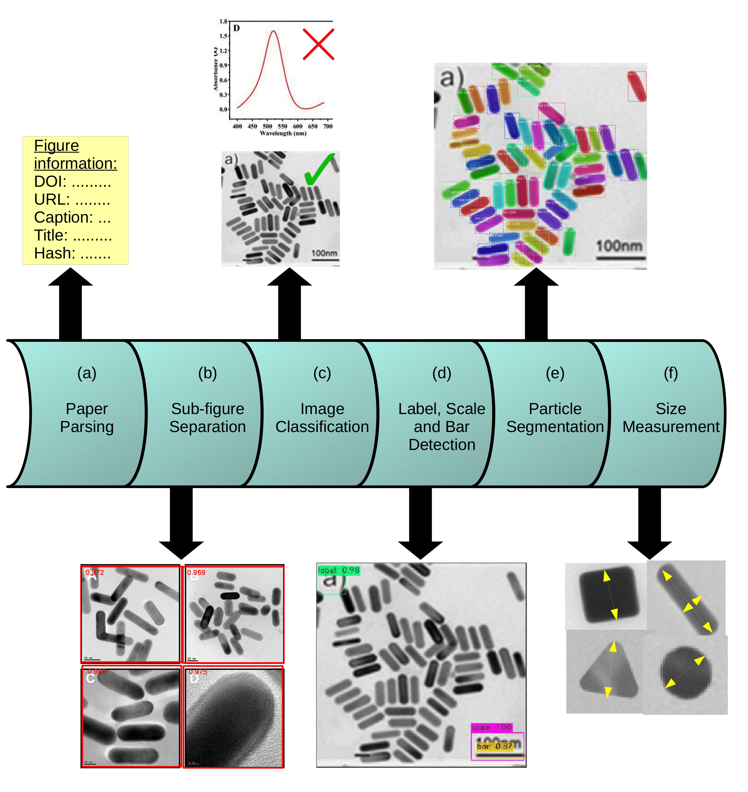

<h1 align="center">TEMExtraction</h1>

<p align="center">
  <strong>Automated Microscopy Figure Analysis and Particle Measurement</strong>
  <br>
  <sub>A research-oriented Python application for extracting quantitative information from scientific microscopy images.</sub>
</p>

<p align="center">
  
  
  
  
</p>

<p align="center">
  <a href="#-overview">Overview</a> •
  <a href="#-features">Features</a> •
  <a href="#-installation">Installation</a> •
  <a href="#-model-weights">Model Weights</a> •
  <a href="#-usage">Usage</a> •
  <a href="#-citation">Citation</a>
</p>

---

## 🔬 Overview

**TEMExtraction** is a research software project for processing microscopy figures and extracting particle-related information from scientific research papers and images.

The repository combines image-processing, classification, figure-separation, scale-bar detection, and particle-segmentation components with a desktop graphical interface. The application provides workflows for supplying inputs, reviewing available results, exploring measurements, and generating PDF analysis reports.

The project is associated with research on literature-mined microscopy images and gold nanoparticle size and morphology.

> **Research software:** This repository contains legacy dependencies and separately distributed model weights. Installation and complete end-to-end compatibility should be verified on the target system.

## ✨ Features

- **Desktop GUI:** A PyQt5 interface for working with microscopy-analysis workflows.
- **Multiple input workflows:** Choose between Research Paper and Manual Image input.
- **GPU option:** A Use GPU control is available for supported configurations.
- **Results overview:** Review available analysis results and summary information.
- **Measurement analysis:** Explore particle-measurement data and statistical visualizations.
- **Graph export:** Save supported graphs in PNG, PDF, or SVG format.
- **Previous results:** Load previously saved results where supported.
- **PDF reports:** Generate a PDF analysis report from available results.
- **Research pipeline:** Includes components for figure separation, classification, scale-bar detection, OCR-related processing, and segmentation.

The availability and output of individual processing stages depend on the selected workflow, installed dependencies, required model files, and input data.

## 🧭 Contents

- [Overview](#-overview)
- [Features](#-features)
- [Pipeline](#-pipeline)
- [Project Structure](#-project-structure)
- [Installation](#-installation)
- [Model Weights](#-model-weights)
- [Datasets](#-datasets)
- [Usage](#-usage)
- [Reports and Exports](#-reports-and-exports)
- [Troubleshooting](#-troubleshooting)
- [Development and Testing](#-development-and-testing)
- [Citation](#-citation)
- [Acknowledgements](#-acknowledgements)
- [License](#-license)

## 🔄 Pipeline

The repository includes an existing diagram illustrating the research pipeline.

<p align="center">
  
</p>

<p align="center">
  <sub>Pipeline illustration from the project documentation.</sub>
</p>

The repository contains several processing components:

1. Figure-separation utilities.
2. Image classification models.
3. Scale-bar localization and OCR-related processing.
4. Particle-segmentation models.
5. Measurement and analysis utilities.
6. GUI-based result review and report generation.

The exact execution order and component dependencies depend on the selected pipeline. Consult the source code and configuration files for implementation details.

## 🗂️ Project Structure

```text
TEMExtraction-main/
├── analysis/                         # Analysis-related components
├── classifier/                       # Image classification models
├── docs/                             # Documentation and pipeline figure
│   └── pipeline_figure.png
├── environment/                      # Legacy Conda environment definitions
│   ├── environment.yml               # Existing main environment configuration
│   └── environment_dataset.yml       # Existing figure-separation configuration
├── figure_separator/                 # Figure-separation implementation
├── gui/                              # Desktop GUI and reporting
│   ├── app.py
│   ├── dark_scientific.qss
│   ├── offline_narrative.py
│   ├── particle_3d_viewer.py
│   ├── report_generator.py
│   ├── report_generator_research.py
│   └── report_generator_flow.py
├── ImageSoup/                        # Image-retrieval utilities
├── label_scale_bar_detector/         # Scale-bar detection and OCR
├── object_classes/                   # Object-class resources
├── particle_segmentation/            # Particle-segmentation components
├── sample/                           # Sample resources
├── test_input/                       # Test inputs
├── pipeline_single.py                # Single-image pipeline implementation
├── test_pipeline_single.py           # Existing pipeline entry script
├── utils.py                           # Shared utilities
├── environment.yml                   # (If supplied in the published repository)
├── README.md
└── LICENSE
```

Downloaded datasets and large model files are maintained separately from the public Git repository.

## Installation

TEMExtraction is intended for **Linux** and uses Conda environments to manage its legacy computer-vision and machine-learning dependencies.

### Prerequisites

- Linux
- Miniconda or Anaconda
- Git
- Access to the required pretrained model weights and datasets listed below

### Clone the repository

```bash
git clone <YOUR_GITHUB_REPOSITORY_URL>
cd TEMExtraction-main
```

Replace `<YOUR_GITHUB_REPOSITORY_URL>` with the actual GitHub repository URL. Adjust the directory name if your cloned folder has a different name.

### Main application environment

The main application uses the `TEM` environment.

```bash
conda env create -f environment/environment.yml
conda activate TEM
python gui/app.py
```

The existing development environment uses Python 3.6.12, PyQt5, OpenCV 3.4.2, PyTorch 1.6.0, TorchVision 0.7.0, TensorFlow 1.14.0, and ReportLab 3.6.5.

### Figure-separation environment

The separate `figure_separator` environment is intended for figure-separation and dataset workflows.

```bash
conda env create -f environment/environment_dataset.yml
conda activate figure_separator
```

This environment uses Python 3.6.12 and TensorFlow 1.0.0. OpenCV currently encounters a shared-library import error on the development machine, so this workflow requires further validation.

### Mask R-CNN GPU environment

A separate environment is available for GPU compatibility experiments.

```bash
conda env create -f environment/environment_maskrcnn_gpu.yml
conda activate maskrcnn_gpu
```

This environment uses Python 3.10.21 and TensorFlow 2.15.1. TensorFlow detects a GPU, but successful inference with the bundled legacy Mask R-CNN implementation has not been verified.

**Important:** The current pipeline uses the Python interpreter running the main pipeline when launching segmentation. Activating `maskrcnn_gpu` separately does not automatically switch the pipeline to that environment.

### Compatibility notes

These environment files were exported from existing Linux environments. Successful recreation on another machine has not yet been verified. Legacy package versions may require additional compatibility work.

GPU detection alone does not guarantee that the complete segmentation pipeline will run successfully.

## 🧠 Model Weights

Large model files are distributed through Google Drive rather than ordinary Git tracking. The links below are the existing project links and must be checked for accessibility, integrity, and redistribution permissions before release.

Download the files and retain the expected filenames.

| Component | Download | Expected file path |
|---|---|---|
| SEM/TEM/Other classifier | [Google Drive](https://drive.google.com/file/d/1UmzfrGB2K9bKjpNcCbFi1SlccrhlUiVf/view?usp=sharing) | `classifier/SEM_TEM_Other_weights/weights_resnet-18_resize.pt` |
| Particulate/Non-Particulate classifier | [Google Drive](https://drive.google.com/file/d/1C6kBePsjeg4NoSaOwrehDdK0X_aSUuc0/view?usp=sharing) | `classifier/Particulate_nonParticulate_weights/weights_resnet-18_resize.pt` |
| Figure separator | [Google Drive](https://drive.google.com/file/d/10hYaPTJgdvfcJoI3amXxyL2Jb-X0ANYq/view?usp=sharing) | `figure_separator/data/figure-sepration-model-submitted-544.pb` |
| SRCNN | [Google Drive](https://drive.google.com/file/d/11GSW2iZ2UuAge5z2oOXIEiEvLp756qXG/view?usp=sharing) | `label_scale_bar_detector/OCR/SRCNN-pytorch/weights/srcnn_x4.pth` |
| Darknet YOLO weights | [Google Drive](https://drive.google.com/file/d/19tT2IpOfo0hE3o4zRFNvPsf8JDw8beOO/view?usp=sharing) | `label_scale_bar_detector/localizer/darknet/backup/yolov4-obj_best.weights` |
| Mask R-CNN | [Google Drive](https://drive.google.com/file/d/15Uo5YZjTrFb0kKaDYo1ctUIV-3leQmsR/view?usp=sharing) | `particle_segmentation/Mask_RCNN/logs/tem/mask_rcnn_tem_0200.h5` |

## 🗃️ Datasets

The full image dataset is large and is intentionally excluded from ordinary Git tracking.

### Dataset metadata

- [Full dataset JSON](https://drive.google.com/file/d/16kMnqD5b4-c3qTi3WB9HaUk3bXESWeDq/view?usp=sharing)
- [Training dataset JSON](https://drive.google.com/file/d/1Iz0Sxx0DqW-_W4XA0oZHarZrLLcbn6Bf/view?usp=sharing)

The original project documentation describes approximately 4,365 literature-mined images and 131 annotated training images. Verify the current dataset files before relying on those counts.

### Downloading datasets

TEMExtraction provides scripts to download the microscopy images using the project's dataset metadata. The images are downloaded locally; they are not stored in the Git repository.

First, create and activate the dedicated environment:

```bash
conda env create -f environment/environment_dataset.yml
conda activate figure_separator
```

Download the required dataset metadata from the links above and place each JSON file at the location expected by its corresponding script.

**Full dataset:**

```bash
python fetch_urls_full_dataset.py
```

**Training dataset:**

```bash
python fetch_urls_training_dataset.py
```

The download scripts may require network access and the availability of the original image sources. Follow the paths and requirements defined in each script, and verify that the downloaded files are complete.

**Compatibility note:** The `figure_separator` environment currently has a known OpenCV shared-library import error on the development machine. Resolve and test this issue before claiming that the complete dataset-download workflow works in a clean installation.


### Dataset considerations

- Download only the data required for your intended workflow.
- Keep large downloaded image collections outside Git.
- Respect the access policies and licensing conditions of the original image sources.
- Do not redistribute downloaded images without confirming the relevant permissions.

## 🚀 Usage

### Launch the desktop application

From the repository root, activate the intended Conda environment and run:

```bash
python gui/app.py
```

The application entry point is `gui/app.py`.

### Choose an input workflow

The GUI provides two input modes:

- **Research Paper** — a research-paper workflow with an article PDF input.
- **Manual Image** — a workflow for supplying an image directly.

Follow the fields and prompts displayed by the running application. Input requirements may differ between modes.

### Run the existing pipeline entry script

The repository also includes this existing command:

```bash
python test_pipeline_single.py
```

Review the script and its input requirements before running it. Its filename alone does not imply that it is a complete automated test suite.

For implementation details, see `pipeline_single.py`.

## 📊 Reports and Exports

The GUI provides tools for reviewing results and exporting supported outputs.

### Graph export

The graph-export dialog supports:

- PNG images
- PDF documents
- SVG vector graphics

### PDF analysis report

The GUI contains a **Generate PDF Report** action. It uses the research-report generator in `gui/report_generator_research.py`.

Additional report-generation modules are available:

- `gui/report_generator.py`
- `gui/report_generator_research.py`
- `gui/report_generator_flow.py`

Generated files should be saved to an appropriate output location. Reports and analysis results may contain research data or local paths, so review them before sharing publicly.

## 🛠️ Troubleshooting

### Conda environment creation fails

Some dependencies are old and may no longer resolve on every operating system. Check the Python version, platform compatibility and full Conda error before changing package versions.

### OpenCV fails to import

The `figure_separator` environment has a known shared-library error involving `libopencv_ccalib.so.3.1`. This must be resolved and tested in that environment before figure separation can be considered fully operational.

### TensorFlow detects a GPU, but Mask R-CNN fails

GPU detection alone does not guarantee compatibility with the bundled legacy Mask R-CNN implementation. Check the TensorFlow and standalone Keras versions, CUDA compatibility, model weights and inference logs.

### The pipeline does not use the separate GPU environment

The current segmentation launcher uses the Python executable running the main pipeline. Activating a different environment in another terminal does not change that interpreter selection.

### Conda cannot create the environment

The environment uses legacy package versions. Record the full Conda error and verify package availability and platform compatibility before modifying pinned dependencies.

### A model file is missing

Check the expected path in the model table, verify the downloaded filename, and confirm that the download completed successfully.

### Dataset scripts cannot locate JSON metadata

Inspect the script's input paths and expected filenames. The full dataset JSON and training metadata may be expected in different locations.

### The GUI starts but a workflow fails

Check the application log, input format, installed dependencies, model paths, and component-specific configuration.

### GPU execution fails

The GPU option requires compatible hardware, drivers, and machine-learning libraries. Try a supported CPU workflow if available, and consult the relevant component documentation.

### PDF report generation fails

Check that the application has valid results to report, the destination is writable, and all report dependencies are installed. Keep the error message for diagnosis.

## 🧪 Development and Testing

The repository includes the original processing code, GUI modules, environment definitions, and an existing single-pipeline entry script.

Before contributing changes:

1. Preserve the legacy working environment where possible.
2. Test changes against representative microscopy inputs.
3. Verify that required model files are present.
4. Check GUI launch, result review, and report generation.
5. Document any changes to dependencies or input/output formats.

The public release should include verified setup instructions and a tested smoke-test procedure.

## 📚 Citation

If you use the research dataset or reproduce the associated research workflow, cite the manuscript:

**Subramanian et al. — Dataset of gold nanoparticle sizes and morphologies extracted from literature-mined microscopy images.**

- Manuscript: https://arxiv.org/abs/2112.01689

```bibtex
@misc{subramanian2021dataset,
  title         = {Dataset of gold nanoparticle sizes and morphologies extracted from literature-mined microscopy images},
  author        = {Akshay Subramanian and Kevin Cruse and Amalie Trewartha and Xingzhi Wang and Paul Alivisatos and Gerbrand Ceder},
  year          = {2021},
  eprint        = {2112.01689},
  archivePrefix = {arXiv},
  primaryClass  = {cond-mat.mtrl-sci}
}
```

## 🙏 Acknowledgements

This project uses or builds upon work associated with:

- [AlexeyAB/darknet](https://github.com/AlexeyAB/darknet)
- [apple2373/figure-separator](https://github.com/apple2373/figure-separator)
- [yjn870/SRCNN-pytorch](https://github.com/yjn870/SRCNN-pytorch)
- [matterport/Mask_RCNN](https://github.com/matterport/Mask_RCNN)

Please consult the upstream repositories for their licenses, attribution requirements, and citation guidance.

## 📜 License

The existing repository contains a `LICENSE` file identifying the MIT License and copyright attribution to Akshay Subramanian (2021).

This notice is preserved from the existing project. It should not be assumed to grant redistribution rights for third-party code, pretrained weights, or datasets. Verify the relevant licenses and permissions before publishing or redistributing those materials.
